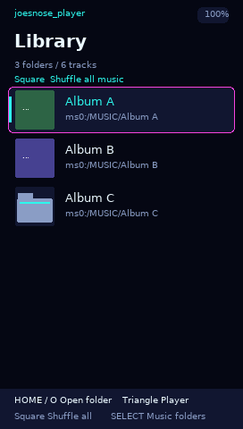
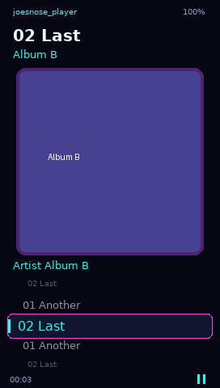

# PSPGo portrait MP3 player

An MP3 player for PSP Go, controllable with the screen closed. Live like it's 2011: portrait mode… hang it from your neck!

Native PSP MP3 playback for **ARK on 6.61**, with album artwork, folder browsing, shuffle and five colour themes. Hold the PSP **90° clockwise** for the 272 × 480 portrait interface.

## Download and install

**[Download v0.15](https://github.com/joesnose/PSPGo-portrait-mp3-player/raw/refs/heads/main/downloads/v0.15/joesnose-portrait-music-v0.15.zip)** · [Release notes](https://github.com/joesnose/PSPGo-portrait-mp3-player/releases/tag/v0.15) · [Checksums](downloads/v0.15/SHA256SUMS.txt) · [Source ZIP](https://github.com/joesnose/PSPGo-portrait-mp3-player/raw/refs/heads/main/downloads/v0.15/joesnose-portrait-music-v0.15-source.zip)

Extract the ZIP into `PSP/GAME/JoeMusic` on your Memory Stick. The application needs:

```text
PSP/GAME/JoeMusic/EBOOT.PBP
PSP/GAME/JoeMusic/music_buttons.prx
```

The app loads its helper itself. **Do not add `music_buttons.prx` to seplugins or PLUGINS.TXT.** The helper provides read-only HOME, volume and slider state; it has no firmware patches or input hooks.

When upgrading, keep `folders.cfg`, `position.txt` and `theme.cfg`. Users upgrading from v0.12–v0.14 can replace just the EBOOT; the helper is unchanged.

Memory Stick launch is the confirmed setup. Internal-storage launch has a `fatms0:` workaround for the PSP Go's storage redirection, but card access from internal launches still needs hardware confirmation.

## Controls

**Face and shoulder button names below are the original labels printed on the PSP.** The face-button actions have been rotated one position counterclockwise for portrait use.

| Button | Action |
|---|---|
| **HOME — short press** | Play the selected song; pause/resume if it is already active. In Library, open the highlighted folder first. |
| **HOME — hold 0.8 seconds** | Open the native PSP HOME / exit menu. |
| **L / R — single tap** | Browse previous / next song within the current folder. Acts on release and does not start playback. |
| **L / R — double tap** | Play previous / next song. Follows the shuffled queue when shuffle is enabled. Tap within 350 ms. |
| **L / R — hold 0.8 seconds** | Browse the previous / next album folder, once per hold. |
| **D-pad Left / Right** | Portrait up / down: scroll songs on the player, or items in Library and menus. |
| **D-pad Down / Up** | Portrait left / right: browse previous / next album on the player. |
| **Circle** | Open the highlighted folder/item, play the selected MP3, or play/pause on the player. On the Theme row, cycle colours. |
| **Triangle** | Back / parent folder. On the player, open Library; in Library, return to the playing song. In Settings, rescan and return to Library. |
| **Cross — on the player** | Stop playback. |
| **Cross — in the folder browser** | Add the current folder and all its subfolders to the library. |
| **Cross — on a selected music root** | Remove that root from the library. |
| **Square — in Library** | Start Shuffle all music. Press again in Library to disable shuffle. |
| **Square — in the folder browser** | Finish browsing and return to Settings. |
| **START** | Open Library from the player; otherwise return to the playing song. |
| **SELECT** | Open Settings: music folders and themes. |
| **Volume + / −** | Normal system volume adjustment, with an on-screen bar. No song-skipping action. |
| **Open the sliding screen** | Bring Library in from the right of the portrait screen. |
| **Close the sliding screen** | Slide Library out to the right and return to the currently playing track. |

Song browsing returns to the playing track after **four seconds without scrolling**. Each scroll restarts that timer; choosing a song to play cancels it. The timer does not dismiss Library or Settings. Music continues while browsing and moving the slider.

If the helper is missing or fails to load, **Circle remains the playback control**, and HOME retains its normal firmware behaviour.

## Music folders and album art

Press **SELECT → Add a music folder**, choose a storage device, and browse to a music folder. Press **Cross** to include that folder and every subfolder. Add more locations if needed, then **Triangle** in Settings to rescan.

Library shows folders containing MP3s, with larger cover tiles and matching folder icons where art is missing. Opening a folder previews its artwork and MP3 list in the player; HOME or Circle plays the highlighted track. Nested folders have separate Library entries. The directory browser shows folders and MP3s only.

Embedded JPEG/PNG art is preferred. Folder images can use names such as `cover.jpg`, `folder.jpg` or `front.jpeg`; other JPEG/PNG filenames are also discovered. Both RGB and CMYK JPEGs are supported. The artist appears below the full-size artwork; missing tags show `Unknown artist`.

## Themes

Use **SELECT → Theme → Circle** to cycle through **Sage**, **Blue**, **Red**, **Yellow** and **Neon**. The first four use muted colours; Neon uses bright cyan and magenta on a near-black background. The choice saves automatically to `theme.cfg`. Real cover images keep their own colours.

| Album Library | Player |
|---|---|
|  |  |

## Saved position and limits

The selected song/folder saves when browsing settles, periodically during playback, and before normal exit. Reopening restores that selection, artwork and track list. File replacement includes a backup for PSP FAT filesystems.

Playback time and active-track metadata are recorded separately, but **resuming audio at that timestamp is not enabled**. Audio does not start automatically. Volume reversal is not enabled. Suspend/resume and internal-launch card access are not guaranteed.

Playback is MP3-only; there is no seek, EQ or streaming. Embedded artwork is limited to 4 MiB and PNG dimensions to 1,024 × 1,024. Firmware decoder limitations still apply. See the [full user guide](docs/USER_GUIDE.md) for scanning limits and diagnostic details.

## Build from source

With PSPDEV/PSPSDK and PSP ports of libpng, libjpeg and zlib:

```sh
make -C helper
make -j2
```

Or with the PSPDEV Docker image:

```sh
docker run --rm -v "$PWD:/src" -w /src pspdev/pspdev:latest sh -c 'make -C helper && make -j2'
```

Copy the resulting `EBOOT.PBP` and `helper/music_buttons.prx` into the app folder. The EBOOT uses a normal-memory request (`MEMSIZE=0`). Generated font data is included; font regeneration is optional.

Portable host checks include:

```sh
cc -std=gnu11 -Isrc src/core.c src/fs.c src/controls.c tests/controls_test.c -o /tmp/joe-controls
/tmp/joe-controls
cc -std=gnu11 -Isrc tests/session_test.c -o /tmp/joe-session
/tmp/joe-session
cc -std=gnu11 -Isrc src/pcm.c src/slide_panel.c tests/pcm_panel_test.c -lm -o /tmp/joe-pcm
/tmp/joe-pcm
```

[Validation results](validation/result.json) distinguish emulator/host checks from hardware tests. Emulator scripts in `tests/` are development harnesses with environment-specific paths; older versioned scripts are retained as history. Their audio/art fixtures are synthetic and are not included in the release.

For troubleshooting, `JOE_MUSIC_LOG.txt` is written beside the EBOOT and replaced each launch. Creating `SAFE_MODE.txt` there bypasses helper loading for diagnosis.

## Credits and licence

BSD-2-Clause; see [LICENSE](LICENSE). The firmware MP3 pipeline is based on Alexander Berl's BSD-licensed PSPSDK MP3 sample. The interface uses DejaVu Sans, libpng, libjpeg and zlib. [Third-party notices](licenses/) are included with the source and install ZIP.
